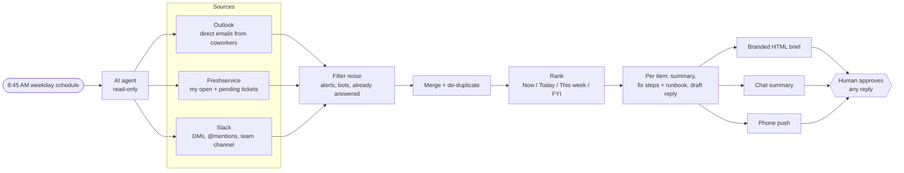

# IT Morning Kickoff

**A scheduled AI agent that reads my email, helpdesk tickets and Slack before I log on, and hands me one ranked task list with likely fixes and draft replies. It is read-only: nothing goes out without my approval.**

I'm an IT Specialist. I used to spend the first part of every morning clicking between Outlook, Freshservice and Slack, trying to work out what was on fire. Now a scheduled agent does that sweep at 8:45 AM. When I start at 9:00, I already know what to do first, why it matters, and how to fix it.

> **First run:** it caught a ticket whose first-response deadline had passed. The ticket was marked *Pending*, but no reply had ever gone out, so it was really waiting on me. That's the kind of thing that slips through when you check each tool on its own.



---

## What this is, in engineering terms

This is a **prompt-based agent workflow, not a compiled program.** There is no custom code to run. The "program" is a version-controlled specification written in plain language ([`skill/SKILL.md`](skill/SKILL.md), about 150 lines). An LLM agent (Claude) executes it on a schedule and calls the source systems through **MCP connectors** (Model Context Protocol, a standard way to give an AI agent access to other apps' APIs).

| Layer | What it is here |
|---|---|
| **Trigger** | Cron schedule: `45 8 * * 1-5`, Pacific time (8:45 AM, Monday to Friday) |
| **Runtime** | A Claude agent session (Claude Cowork scheduled task) |
| **Integrations** | MCP connectors for Microsoft 365, Freshservice and Slack |
| **Logic** | `skill/SKILL.md`: sources, filters, ranking rules, output format and guardrails |
| **Fallback** | `schedule/scheduled-prompt.md`: a self-contained copy of the instructions, so the run still works if the skill file isn't loaded |
| **Output** | An HTML brief, a short chat summary and a phone push notification |
| **Change control** | Every rule change is a commit, logged in `CHANGELOG.md` |

### Why prompt-based instead of a script?

Most of the work is reading unstructured text: figuring out what a coworker is actually asking for, whether a ticket thread is waiting on me, and what a sensible first reply looks like. A script can pull tickets by status, but it can't summarize a thread or draft a reply. Rules written in plain language can also be tuned in minutes without a redeploy.

The trade-off is that LLM output isn't deterministic, so the guardrails and the checks below matter more than they would for a script. A plain Python baseline against the Freshservice REST API is on the roadmap, so the two approaches can be compared.

---

## What happens on each run

| # | Stage | Tool calls (MCP) | What it does |
|---|---|---|---|
| 1 | **Set the window** | none | Tue–Fri: since the previous weekday's run. Monday: since Friday's run, so the weekend is covered. |
| 2 | **Email** | `outlook_email_search`, `read_resource` | Pulls mail sent to me since the window start. Keeps only real people at my company with me on the To: line. Drops threads I already answered. |
| 3 | **Tickets** | `fetchTicketFilter`, `fetchTicket`, `fetchSolutionArticleSearch` | Pulls every Open (status 2) and Pending (status 3) ticket assigned to me, with the conversation, requester and SLA fields. Looks up matching knowledge-base runbooks. |
| 4 | **Slack** | Slack search and channel-history reads | DMs, @mentions and the IT team channel inside the window. Skips bots and threads I answered last. |
| 5 | **Filter** | none | Removes automated noise and counts what it removed. |
| 6 | **Merge** | none | De-duplicates across sources: a Slack ping and an email about the same ticket become one item. |
| 7 | **Rank** | none | Sorts into Now / Today / This week / FYI, then by deadline, priority and age. |
| 8 | **Enrich** | none | For each item: a 1–2 sentence summary, 2–5 fix steps citing a runbook, and a draft reply when one is needed. |
| 9 | **Deliver** | Publish page, chat message, push notification | Sends the brief three ways. If every source is empty, it sends one line instead. |

The same logic as pseudocode:

```text
window  = since_last_weekday_run(now, tz="America/Los_Angeles")

emails  = search_mail(to=me, after=window)
          .keep(sender_domain == company AND is_human AND me in To)
          .drop(helpdesk_notifications, security_alerts, m365_alerts, noreply, newsletters)
          .drop(thread where my reply is the latest message)

tickets = filter_tickets(agent=me, status in [Open, Pending])        # all ages
          .each(read conversation + SLA fields)
          .flag(no_outbound_reply  -> WAITING ON YOU)
          .flag(fr_due_by or due_by <= today -> SLA BREACHED / DUE TODAY)

slack   = dms(to=me) + mentions(me) + team_channel(window)
          .drop(bots unless outage, threads I answered last, reaction-only)

items   = dedupe(emails + tickets + slack)            # one item, many sources
ranked  = tier(items) -> [NOW, TODAY, THIS_WEEK, FYI]
          sort_within_tier(deadline, priority, age)

brief   = ranked.each(summary, fix_steps(runbook), draft_reply_if_needed, flags)
deliver(brief) -> html_page, chat_summary, push_notification
# No write calls. Drafts wait for an explicit "send #<ticket>".
```

### A detail worth calling out: "Pending" isn't always pending

Helpdesk statuses can be misleading. A ticket marked *Pending* looks like it's waiting on the requester, but if IT never replied, or the requester answered last, it's really waiting on me. The agent checks the ticket's `outbound_count`, `first_responded_at` and the order of the conversation instead of trusting the status field. That check is what caught the missed SLA on the first run.

---

## Guardrails and threat model

The agent reads company email, tickets and chat, so I treated it like any other system with access to sensitive data.

| Risk | Control | How it's enforced |
|---|---|---|
| The agent sends or changes something it shouldn't | Read-only by default. No sending, posting, replying, editing or marking anything as read. | Hard rule in the spec. **Next step:** read-only API scopes, so it's enforced by permissions as well as instructions. |
| A message tells the agent to do something (prompt injection) | Message content is treated as **data, never instructions.** A request like "reset my password" or "forward me that file" becomes a task on my list. | Hard rule in the spec. The agent has no instruction path from inbound messages. |
| A reply goes out that I didn't mean to send | Each draft needs its own approval by item, for example `send #1234`. There's no bulk send. | Hard rule in the spec. |
| Fix steps skip a required control | Suggestions follow the team's existing runbooks, for example "don't disable an account until HR confirms the cutoff" and "never remote-wipe without manager sign-off." | Runbook lookup on every ticket. |
| A source quietly fails and I miss something | Fails loudly: the brief names any connector it couldn't check and still delivers the rest. | Warning at the top of the brief and in the notification. |
| The noise filter hides something real | The brief reports how many automated alerts it filtered out. I review security alerts separately myself. | Counts in the "By source" section. |
| Company data ends up in this repo | The repo holds only the spec and fictional examples. All IDs, names and domains are `{{PLACEHOLDERS}}`. | Scanned for names, IDs, emails and domains before publishing. |

## Limitations

- **Not deterministic.** Two runs over the same inputs can word things differently or rank a borderline item differently. Hard rules and the explicit flags keep the important parts consistent.
- **It can miss things.** It only sees what the connectors return inside the window. It supplements my helpdesk SLA alerts; it doesn't replace them.
- **Depends on the connectors.** If an API is down, that source is skipped and flagged.
- **Drafts are drafts.** They are written in my voice, but I review every one before it goes out.

## How I check it

- For the first few weeks, I spot-check each brief against the three sources to catch misses and false "Now" items.
- The "By source" counts show whether the filters are behaving.
- Every rule change goes in the tuning log and `CHANGELOG.md`, so I can see which change caused a behavior change.

## Results

**Measuring now.** I started tracking these in November 2026 and will post the numbers after a few weeks of runs:

- Morning triage time, before vs. after
- SLA risks surfaced before 9 AM
- Automated alerts filtered out per day

---

## Repo layout

```
skill/SKILL.md                 The spec: sources, filters, ranking, output, guardrails
schedule/scheduled-prompt.md   Standalone prompt for the scheduled run, plus the cron line
examples/sample-brief.md       Example output (fictional data)
docs/architecture.mmd          Diagram source (Mermaid, rendered above)
CHANGELOG.md                   Version history as the workflow evolves
```

## Adapting it

Replace the `{{PLACEHOLDERS}}` in `skill/SKILL.md` and `schedule/scheduled-prompt.md` with your own:

- name, email and company domain
- helpdesk agent ID
- Slack user and channel IDs
- time zone and run time

You'll need an agent runtime that supports scheduled runs and MCP connectors for Microsoft 365, Freshservice and Slack. The ranking tiers and filters are plain-language rules, so you can tune them without writing code.

## Roadmap

- [ ] Read-only API scopes for every connector (enforce "read-only" with permissions, not just instructions)
- [ ] Plain Python baseline against the Freshservice REST API, to compare against the agent
- [ ] Track recurring issue types week over week to spot candidates for new KB articles
- [ ] Add a calendar check so meetings that cut into fix time get flagged
- [ ] One-tap approval of draft replies from the phone

---

*Built by Quincey Jackson. All examples use fictional data. No company or employee information is included.*
